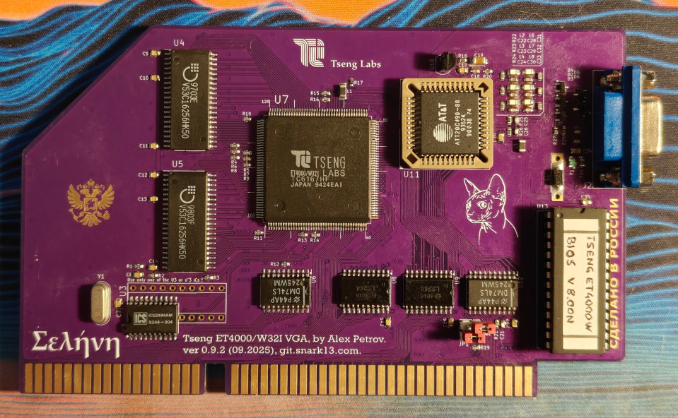
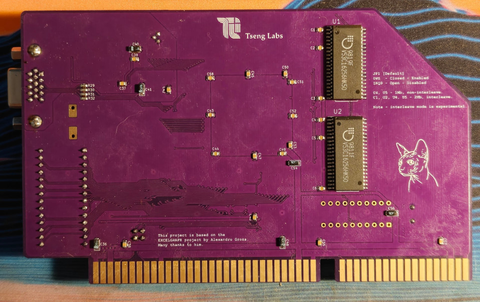
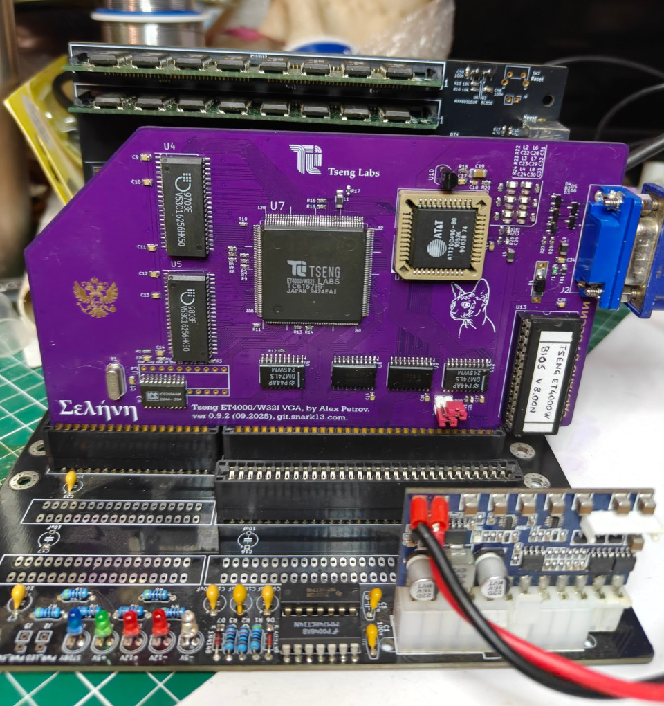

# Selena VGA Card

[Русская версия](README_RU.md)

Selena is a VGA graphics card for the 16-bit ISA bus, based on the Tseng Labs ET4000/W32i. The project is designed in KiCad and uses a two-layer PCB.

Selena is based on Alexandru Groza’s [EXCELGRAPH ISA Video Display Controller](https://www.alexandrugroza.ro/microelectronics/system-design/isa-video-display-controller/index.html). It changes the component placement, routing, and video memory connections, and reduces the PCB layer count from four to two.

## Project status

Version 0.9.2 has been assembled and tested with both 1 MB and 2 MB of video memory. Memory interleaving works reliably with V53C16256HK50 chips.

Release files for version 1.0.2 are available in the repository. The test results above apply to version 0.9.2.

## Key features

- VGA compatibility.
- Fast video memory access in MS-DOS.
- Hardware graphics acceleration in Microsoft Windows.
- Video digital-to-analog converter (RAMDAC) with True Color support.
- Two video memory configurations: 1 MB or 2 MB.
- Two-layer PCB for the 16-bit ISA bus.

## Video memory configurations

| Capacity | Mode | Chips to populate | Notes |
| --- | --- | --- | --- |
| 1 MB | Linear | U4, U5 | Less demanding of the memory chips used. |
| 2 MB | Interleaved | U1, U2, U4, U5 | Offers higher performance; stability depends on the memory chips used. |

The 1 MB configuration can also accommodate chips that are unstable in the 2 MB interleaved configuration, without the additional CAS line delays used in the original project. Compatibility with specific chips must be verified on an assembled board.

## Project files

- [selena.kicad_pro](selena.kicad_pro) — KiCad project.
- [selena.kicad_sch](selena.kicad_sch) — schematic.
- [selena.kicad_pcb](selena.kicad_pcb) — PCB layout.
- [selena.pretty/](selena.pretty/) — local footprint library.
- [docs/](docs/) — reference documentation.
- [release/](release/) — release files: Gerber files, PDF schematics, and interactive bills of materials.
- [images/0.9.2/](images/0.9.2/) — photos of the assembled version 0.9.2 board.

### Release files

| Version | Gerber files | Schematic | Interactive bill of materials |
| --- | --- | --- | --- |
| 1.0.2 | [ZIP](release/1.0.2/gerbers-1.0.zip) | [PDF](release/1.0.2/selena.pdf) | [HTML](release/1.0.2/ibom.html) |
| 0.9.2 | [ZIP](release/0.9.2/gerbers.zip) | [PDF](release/0.9.2/selena.pdf) | [HTML](release/0.9.2/ibom.html) |

## Revision history

### 1.0.2

- Corrected PCB markings.
- Connected pin 3 of the ICS2494-304 clock generator to ground as specified in its documentation.

### 0.9.2

- Optimized component placement and video memory bus routing; memory chips are placed on both sides of the PCB.
- Changed the video memory connections from the original design and added a 1 MB configuration using two memory chips.
- Changed all capacitors below 0.1 µF to the 0805 package size.
- Renumbered components.

### 0.7

- Added support for mounting the RAMDAC in a PLCC44 socket.
- Added an alternative footprint for the video clock generator: U'3 can be populated instead of U3. Supported options are the CH9294E in DIP or SOIC packages and the ICS2494-304 in an SOIC package.

### 0.3

- Initial project version.

## Photos

Assembled version 0.9.2 board.

