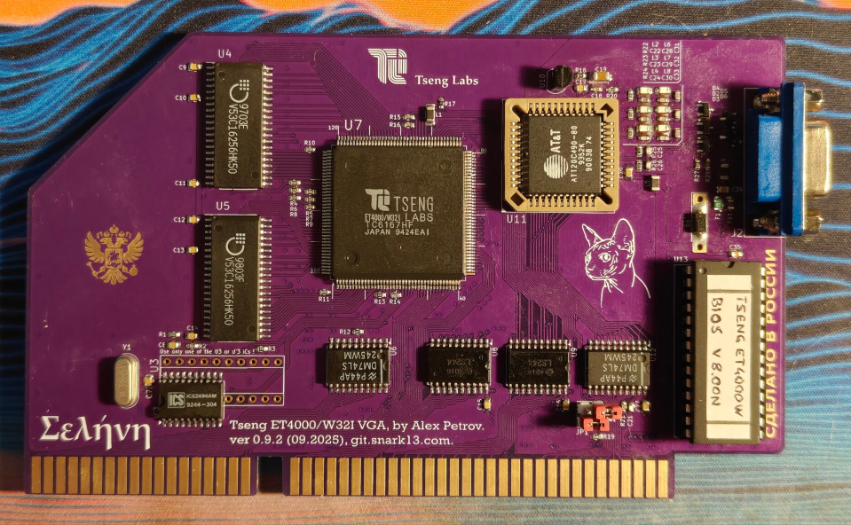
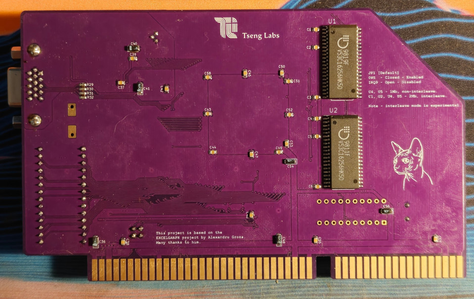
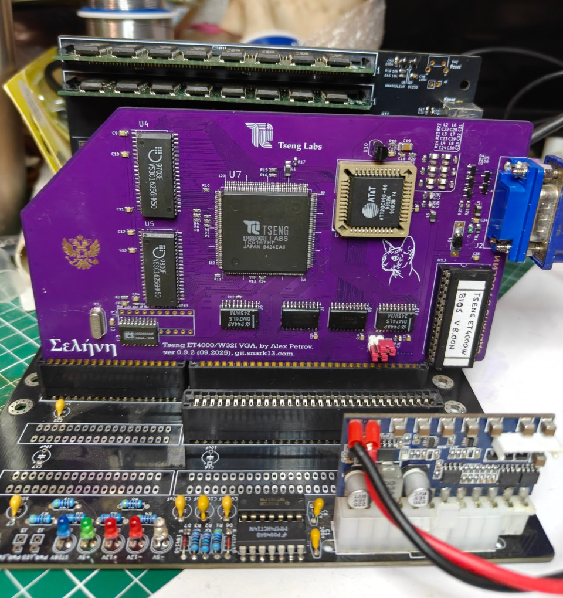

# Selena VGA card

[English version](README.md)

Selena — видеокарта для 16-разрядной шины ISA на базе Tseng Labs ET4000/W32i. Проект выполнен в KiCad и использует двухслойную печатную плату.

В основе Selena лежит проект [EXCELGRAPH ISA Video Display Controller](https://www.alexandrugroza.ro/microelectronics/system-design/isa-video-display-controller/index.html) Александру Грозы (Alexandru Groza). По сравнению с исходным проектом изменены компоновка, разводка и подключение видеопамяти; число слоёв платы сокращено с четырёх до двух.

## Состояние проекта

Версия 0.9.2 собрана и протестирована с 1 и 2 МБ видеопамяти. С микросхемами V53C16256HK50 режим чередования банков памяти работает стабильно.

Материалы выпуска 1.0.2 доступны в репозитории. Сведения об испытаниях выше относятся к версии 0.9.2.

## Основные характеристики

- Совместимость с VGA.
- Высокая скорость работы с видеопамятью в MS-DOS.
- Аппаратное ускорение графики в Microsoft Windows.
- Цифро-аналоговый преобразователь видеосигнала (RAMDAC) с поддержкой True Color.
- Две конфигурации видеопамяти: 1 или 2 МБ.
- Двухслойная печатная плата для 16-разрядной шины ISA.

## Конфигурации видеопамяти

| Объём | Режим | Устанавливаемые микросхемы | Особенности |
| --- | --- | --- | --- |
| 1 МБ | Линейный (linear) | U4, U5 | Менее требователен к используемым микросхемам памяти. |
| 2 МБ | Чередование банков (interleave) | U1, U2, U4, U5 | Обеспечивает более высокую производительность; стабильность зависит от используемых микросхем памяти. |

Конфигурация на 1 МБ позволяет использовать в том числе микросхемы, нестабильные в режиме чередования банков на 2 МБ, без дополнительных задержек на линиях CAS, применяемых в исходном проекте. Совместимость конкретных микросхем необходимо проверять на собранной плате.

## Файлы проекта

- [selena.kicad_pro](selena.kicad_pro) — проект KiCad.
- [selena.kicad_sch](selena.kicad_sch) — принципиальная схема.
- [selena.kicad_pcb](selena.kicad_pcb) — печатная плата.
- [selena.pretty/](selena.pretty/) — локальная библиотека посадочных мест.
- [docs/](docs/) — справочная документация.
- [release/](release/) — материалы выпусков: Gerber-файлы, схема в PDF и интерактивный список компонентов.
- [images/0.9.2/](images/0.9.2/) — фотографии собранной платы версии 0.9.2.

### Материалы выпусков

| Версия | Gerber-файлы | Схема | Интерактивный список компонентов |
| --- | --- | --- | --- |
| 1.0.2 | [ZIP](release/1.0.2/gerbers-1.0.zip) | [PDF](release/1.0.2/selena.pdf) | [HTML](release/1.0.2/ibom.html) |
| 0.9.2 | [ZIP](release/0.9.2/gerbers.zip) | [PDF](release/0.9.2/selena.pdf) | [HTML](release/0.9.2/ibom.html) |

## История изменений

### 1.0.2

- Исправлены надписи на плате.
- Вывод 3 генератора тактовой частоты ICS2494-304 подключён к земле в соответствии с документацией.

### 0.9.2

- Оптимизированы расположение компонентов и разводка шин видеопамяти; микросхемы памяти размещены с обеих сторон платы.
- Изменено подключение видеопамяти по сравнению с исходным проектом; добавлена конфигурация на 1 МБ с двумя микросхемами памяти.
- Для всех конденсаторов ёмкостью менее 0,1 мкФ выбран типоразмер 0805.
- Изменена нумерация компонентов.

### 0.7

- Добавлена возможность установки RAMDAC в панельку PLCC44.
- Добавлено альтернативное посадочное место для генератора тактовой частоты видеосигнала: вместо U3 можно установить U'3. Поддерживаются CH9294E в корпусах DIP и SOIC, а также ICS2494-304 в корпусе SOIC.

### 0.3

- Первая версия проекта.

## Фотографии

Собранная плата версии 0.9.2.

